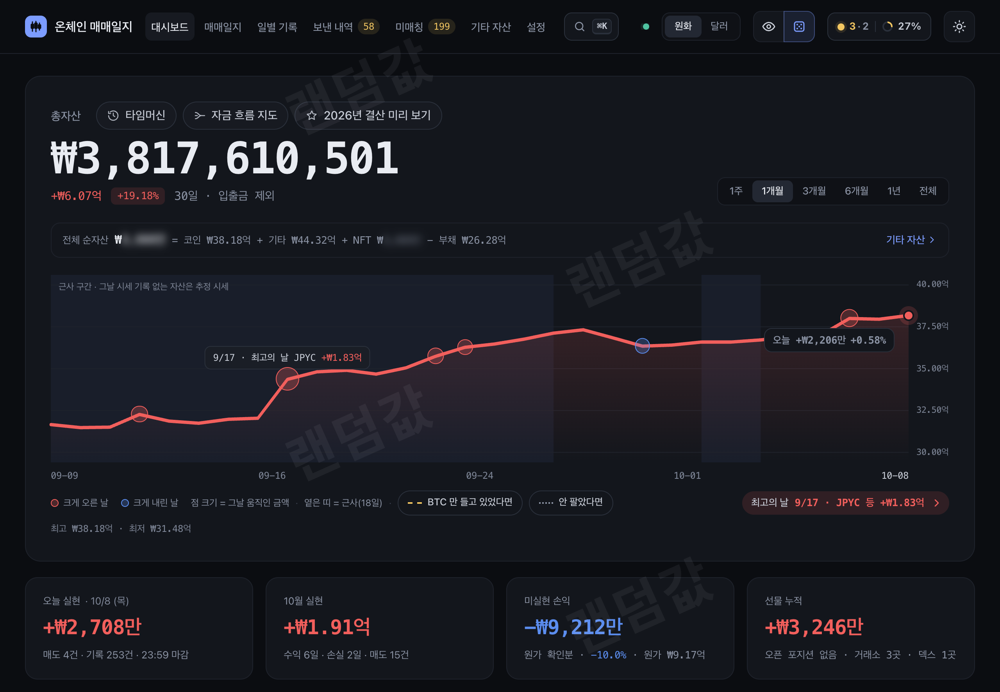
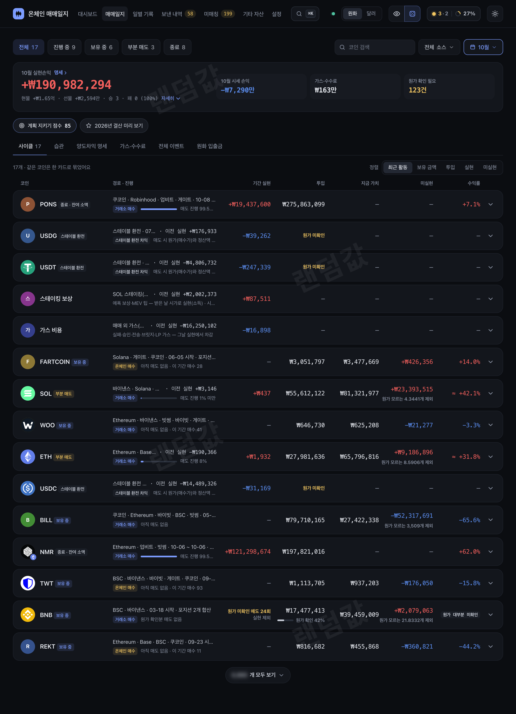
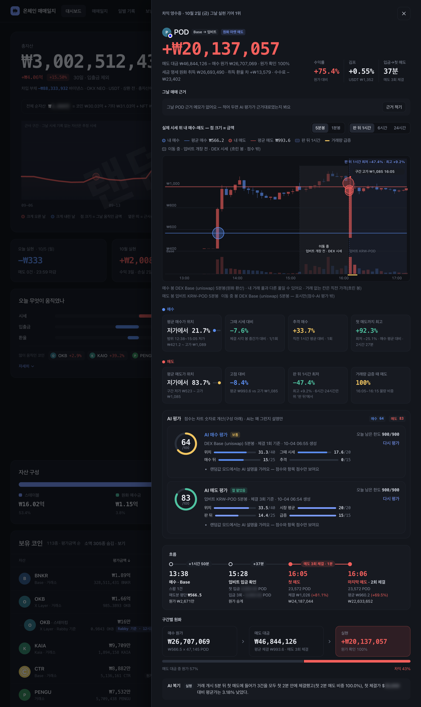
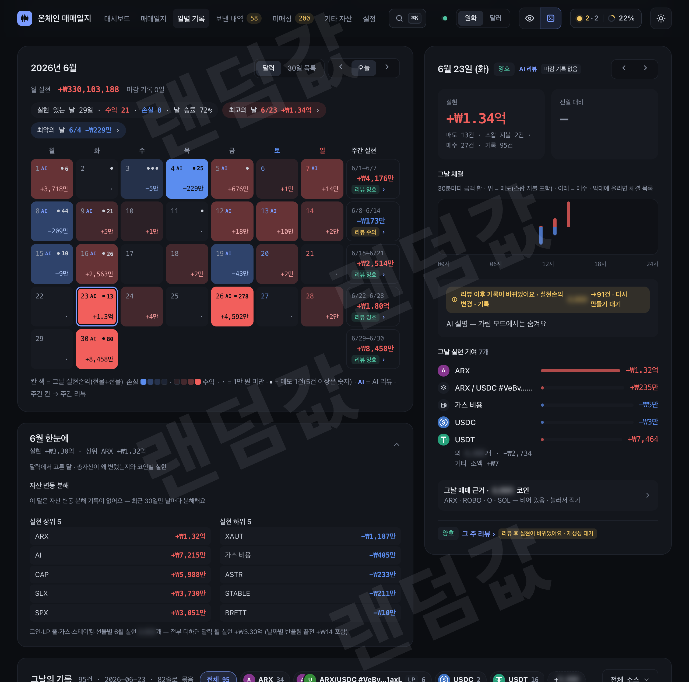
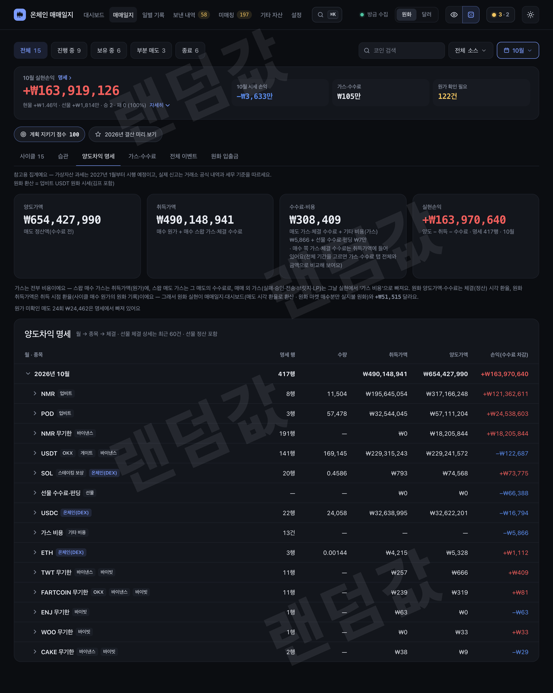
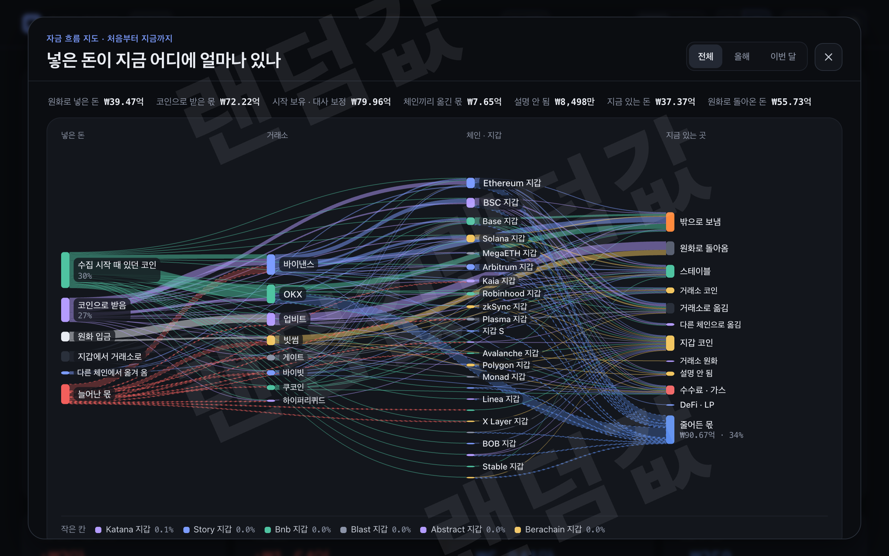
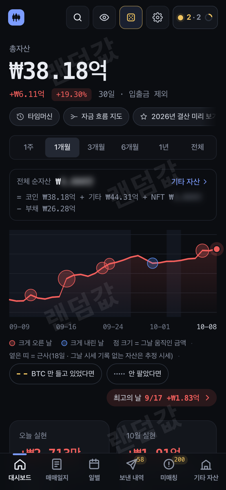

# tj-bot · 온체인 매매일지

내 지갑 주소와 거래소 **조회 전용** API 키만으로 코인 매매일지를 자동으로 만드는 셀프 호스팅 봇입니다.
온체인 스왑·전송·LP 와 거래소 입출금·체결을 하나의 원장(SQLite)으로 이어 붙여
**원가·실현/미실현 손익·일별 기록·신고용 명세**를 보여 줍니다.
모든 데이터는 내 컴퓨터(`state/`)에만 저장되고, 화면은 기본적으로 이 컴퓨터(127.0.0.1)에서만 열립니다.

*English summary is at the bottom — [English](#english).*

> **원가 계산 방식 = 이동평균(평균 단가 · 선입선출 아님)** — 금액은 모두 달러로 계산하고, 원화는 업비트 USDT 원화 시세로 바꿔 보여 줘요.
> 평단 = 남은 원가 ÷ 원가를 아는 수량이에요(체인 기본 코인·정품 스테이블은 체인을 넘어 한 평단, 그 밖 토큰은 컨트랙트마다, 거래소 보유는 거래소·코인마다).
> 내 지갑·거래소 사이 이동은 손익이 없고 출발지 평단 원가를 그대로 들고 가요. 원가를 모르는 수량은 기본으로 처음 생긴 날 시가로 추정('추정' 표시)하고,
> 그 값도 없으면 평단에서 빼 두었다가 팔리면 '원가 미확인'으로 보여요. 실현 손익·신고용 명세도 이 평단 기준이에요 — 자세히는 [원가 · 손익 계산 방식](docs/FEATURES.md#원가--손익-계산-방식).

<br><sub>금액은 랜덤값</sub>

### 무엇을 볼 수 있나요

- **대시보드** — 총자산 · 전일 대비 변동 원인 · 장기 총자산 곡선 · 평단·손익
- **매매일지 · 차익 영수증** — 코인별 사이클(투입 → 매도) · 산 곳·판 곳을 시세 차트 위 점으로 · 선물 정산 영수증
- **일별 기록** — 날마다 실현손익 달력 · 그날 무엇이 움직였나 · 매매 근거 메모 · 'M월 한눈에'
- **신고용 명세** — 양도차익 명세(참고용 표) · 가스·수수료
- **추적** — 지갑·거래소 이동과 브릿지를 이어 원가 유지 · 보낸 내역 · 원가 모르는 유입·스팸
- **돌아보기** — 타임머신 · 자금 흐름 지도 · 팔기 전 미리보기 · 올해 결산 · 매매 습관 · 전체 검색(⌘K)
- **상태 패널 · 텔레그램 알림** — 수집기·잔고 대조·백업 상태 · 즉시/하루 요약/시스템 알림
- **기타 자산·NFT** — 부동산·주식·부채를 더한 전체 순자산(NFT 는 선택)
- **모바일 화면** · 금액 랜덤값·가리기(화면 공유용) · AI 리뷰(선택 · 기본 꺼짐)

| | |
|---|---|
| <br><sub>매매일지 · 금액은 랜덤값</sub> | <br><sub>차익 영수증 · 금액은 랜덤값</sub> |
| <br><sub>일별 기록 · 금액은 랜덤값</sub> | <br><sub>양도차익 명세 · 금액은 랜덤값</sub> |
| <br><sub>자금 흐름 지도 · 금액은 랜덤값</sub> | <br><sub>모바일 · 금액은 랜덤값</sub> |

화면 전체는 [화면 미리보기](docs/SCREENS.md#화면-미리보기), 기능 자세히는 [기능 요약](docs/FEATURES.md#기능-요약).

**목차** — [처음 시작하면 이것부터](#처음-시작하면-이것부터) · [화면 미리보기](docs/SCREENS.md#화면-미리보기) · [변경 내역(CHANGELOG)](CHANGELOG.md)

- [설치 자세히](docs/INSTALL.md#설치-자세히): [준비물](docs/INSTALL.md#1-준비물) · [받기·설치 점검](docs/INSTALL.md#2-받기--설치-점검) · [키 준비](docs/INSTALL.md#3-키-준비--env-와-configjson) · [실행·설정 마법사](docs/INSTALL.md#4-실행--설정-마법사) ·
  [첫 실행](docs/INSTALL.md#5-첫-실행--얼마나-걸리고-어디서-보나) · [화면 열기·다른 기기](docs/INSTALL.md#6-화면-열기--다른-기기에서-보기) · [서버에서 늘 켜 두기](docs/INSTALL.md#6-1-서버리눅스에서-늘-켜-두기) · [문제 해결](docs/INSTALL.md#7-문제-해결--자주-묻는-5가지)
- 참고: [원가 · 손익 계산 방식](docs/FEATURES.md#원가--손익-계산-방식) · [기능 요약](docs/FEATURES.md#기능-요약) · [구조](docs/OPERATIONS.md#구조) · [보안·데이터](#보안--데이터) · [고급 설정(환경변수·설정 키)](docs/CONFIG.md#고급-설정) · [알아 둘 것](#알아-둘-것) · [시험 실행](#시험-실행) · [라이선스](#라이선스) · [업데이트](#업데이트) · [멈추기·지우기](#멈추기--지우기)

---

## 처음 시작하면 이것부터

| 순서 | 할 일 | 명령·위치 |
|---|---|---|
| 1 | **Python 3.9+** 가 있는 macOS/Linux 준비 (pm2 는 선택) | `python3 --version` |
| 2 | 받고 설치 점검 — 아무것도 설치하지 않습니다 | `git clone <저장소 주소> tj-bot`(이 페이지 위 **Code** 버튼의 HTTPS 주소) → `cd tj-bot` → `bash tools/setup.sh` |
| 3 | 키 준비 — Solana 지갑이 있으면 Helius, EVM 지갑이 있으면 Etherscan·Alchemy·Ankr 무료 키가 필수(EVM 키 셋은 경고만 — 없어도 돌지만 옛 기록이 늦거나 옛 보유 토큰 찾기·쉬는 지갑 입금 확인이 약해짐), 나머지는 선택 | [키 표](docs/INSTALL.md#3-키-준비--env-와-configjson) · 거래소 키는 **조회 권한만** |
| 4 | 실행 | `pm2 start ecosystem.config.js` (pm2 없이: [아래](docs/INSTALL.md#4-실행--설정-마법사)) |
| 5 | 화면 열기 → 첫 비밀번호 만들기(**설정 코드** = `cat state/auth_setup_code`) → 설정 마법사에서 지갑·키·거래소·텔레그램 | **http://127.0.0.1:8023/** (`web.port` 를 바꿨으면 그 번호) |
| 6 | 첫 백필 기다리기 — 보통 수십 분, 많으면 몇 시간(총자산은 지금 잔고로 보통 몇 분, 전부 들기까지 길면 30분쯤 · 최신 거래는 첫 주기부터 먼저, 옛 기록은 뒤에서 채워요) | 화면 위 **상태 패널** |
| 7 | 남은 '원가 미확인'만 정리 | **미매칭** 탭 |

먼저 구경만 하려면 `bash tools/setup.sh --demo` — 합성 데이터로 화면만 띄우고 아무것도 저장하지 않습니다(포트를 바꾸려면 `TJ_PORT=8024 bash tools/setup.sh --demo`).

오래 켜 둘 거라면 두 가지도 해 두세요 — 로그가 끝없이 커지지 않게 **로그 자르기**(pm2 를 쓰면 `pm2 install pm2-logrotate`, 아니면 크론에 `bash tools/rotate_logs.sh`),
디스크 사고에 대비해 **서버 밖 백업**([백업 · 복구](docs/OPERATIONS.md#백업--복구)).

> **업데이트 안내 — 이미 쓰던 설치라면:** 이번 판부터 `config.json` 에 `web.login` 이 **없어도 로그인이 켜집니다.**
> 업데이트 뒤 `pm2 restart tj-web` 하고 **이 컴퓨터에서** http://127.0.0.1:8023/ 을 열어 비밀번호부터 만드세요
> (그 전까지 다른 기기·프록시에서는 401 — 첫 비밀번호는 이 컴퓨터에서만 만들 수 있습니다). 같은 컴퓨터의 tj-review 는 내부 토큰으로 그대로 동작합니다.
> 계속 끄려면 `"web": {"login": {"enabled": false}}` 를 적고 재시작하세요(끄면 리버스 프록시·터널로 온 요청은 전부 거부됩니다).

---

## 문서 지도

- [docs/SCREENS.md](docs/SCREENS.md): [화면 미리보기](docs/SCREENS.md#화면-미리보기)
- [docs/INSTALL.md](docs/INSTALL.md): [설치 자세히](docs/INSTALL.md#설치-자세히)
- [docs/FEATURES.md](docs/FEATURES.md): [지갑 주소 여러 개 한 번에](docs/FEATURES.md#지갑-주소-여러-개-한-번에) · [AI 기능 켜기 — `claude` CLI 로그인](docs/FEATURES.md#ai-기능-켜기--claude-cli-로그인) · [텔레그램 알림 설정](docs/FEATURES.md#텔레그램-알림-설정) · [금액 랜덤값 모드](docs/FEATURES.md#금액-랜덤값-모드) · [금액 가리기(숨김 모드)](docs/FEATURES.md#금액-가리기숨김-모드) · [기타 자산 — 증권사 연결은 미검증](docs/FEATURES.md#기타-자산--증권사-연결은-미검증) · [NFT 보유 · 바닥가](docs/FEATURES.md#nft-보유--바닥가) · [Hyperliquid — 현물 · 무기한 · 스테이킹](docs/FEATURES.md#hyperliquid--현물--무기한--스테이킹) · [시세 출처 · 동명 코인 거르기](docs/FEATURES.md#시세-출처--동명-코인-거르기) · [일별 기록 — 그날 카드 · 'M월 한눈에'](docs/FEATURES.md#일별-기록--그날-카드--m월-한눈에) · [옛 보유 토큰 찾기 · 체인 표](docs/FEATURES.md#옛-보유-토큰-찾기--체인-표) · [기능 요약](docs/FEATURES.md#기능-요약) · [원가 · 손익 계산 방식](docs/FEATURES.md#원가--손익-계산-방식)
- [docs/OPERATIONS.md](docs/OPERATIONS.md): [백필 · 재구축 · 재백필](docs/OPERATIONS.md#백필--재구축--재백필) · [백업 · 복구](docs/OPERATIONS.md#백업--복구) · [구조](docs/OPERATIONS.md#구조) · [보정 감시](docs/OPERATIONS.md#보정-감시--설명-안-된-보정) · [알려진 한계](docs/OPERATIONS.md#알려진-한계)
- [docs/CONFIG.md](docs/CONFIG.md): [알아 두면 좋은 키](docs/CONFIG.md#알아-두면-좋은-키) · [고급 설정](docs/CONFIG.md#고급-설정)
- [docs/SECURITY_DATA.md](docs/SECURITY_DATA.md): [보안 · 데이터](docs/SECURITY_DATA.md#보안--데이터)
- [docs/README_EN.md](docs/README_EN.md): [English](docs/README_EN.md#english)
- [docs/INSTALL_EN.md](docs/INSTALL_EN.md): [Installation in detail (English)](docs/INSTALL_EN.md#installation-in-detail)
- [docs/SECURITY_DATA_EN.md](docs/SECURITY_DATA_EN.md): [Security · data (English)](docs/SECURITY_DATA_EN.md#security--data)

## 업데이트

이 설치의 버전은 화면 **설정** 맨 아래(`VERSION` 파일 · `/api/health` 의 `version`)에 보입니다.

1. 멈추기 — `pm2 stop ecosystem.config.js`(pm2 없이: 각 터미널에서 Ctrl+C) · AI 리뷰(`tj-review`)를 켠 설치는 이 단계부터 5단계까지 같은 터미널에서 먼저 `export TJ_ENABLE_REVIEW=1`(없으면 `tj-review` 가 멈추기·다시 켜기에서 빠져요)
2. 백업 확인 — 상태 패널 '원장 백업'이 초록인지, `python3 tools/ledger_restore.py list` 맨 위가 최근 것인지
   (없으면 유닛을 멈춘 지금 `cp state/ledger.db state/ledger.db.pre_update_$(date +%Y%m%d)` 로 한 벌)
3. 받기 — `git pull`
4. 점검 — `bash tools/setup.sh`(아무것도 설치하지 않음 · 설정 파일·권한 확인)
5. 다시 켜기 — `pm2 start ecosystem.config.js`(새 유닛·설정까지 붙게 restart 대신 start) → 설정 맨 아래 버전이 바뀌었는지 · 상태 패널이 초록인지
6. 저장 — `pm2 save`(새 유닛까지 지금 목록을 저장 — 안 하면 재부팅 때 pm2 가 예전 목록을 되살려 새로 붙은 유닛(예: `tj-tron`·`tj-ton`)이 빠져요)

**되돌리기** — 멈춘 뒤(1단계) **지금 코드 그대로** `python3 tools/rollback_check.py <예전 버전의 커밋·태그> && python3 tools/candles_compact.py --expand --apply && git checkout <예전 버전의 커밋·태그>` → 다시 켜기.
봉 캐시는 **checkout 전에** 지금 코드로 평문 복원하세요. `tj-web`·`tj-review` 는 복원부터 checkout 까지 멈춘 채로 두세요(예전 판에는 이 복원 도구가 없어요).
점검(`tools/rollback_check.py`)이 거부하면(종료 코드 1) checkout 하지 마세요 — 원장에 1회 정정 도구(`tools/ledger_rowfix.py`)가 남긴 표식이 있는데 그 예전 코드는
그 표식을 읽지 않아, 정정으로 지운 입출금을 원본에서 다시 기장합니다(데이터 개정 번호가 같아 예전 코드가 스스로 못 막아요). 그때는 안내대로 지금 코드로 먼저
정정을 되돌리고(`python3 tools/ledger_rowfix.py --undo <state/ledger_rowfix_undo_….json> --apply`) 점검을 다시 돌리거나, 그 정정 **전** 백업으로 원장째 되돌리세요.
원장의 데이터 개정 번호(`meta data_rev` · 자동 처리 행 = 2)가 그 예전 판의 코드(`src/db.py` DATA_REV)보다 새로워도 거부합니다 — 그때는 지금 코드로 자동 처리를 칸마다 되돌리고
(`python3 tools/ledger_rowfix.py --undo-autofix <거래소>:<심볼> --apply` 전부 → `--data-rev-down 1 --apply`) 점검을 다시 돌리세요.
확인 불가(종료 코드 2)도 되돌리지 마세요. 업데이트가 원장 내용을 한 방향으로 바꿨다면(CHANGELOG 에 '데이터 개정 N' 이라고 적어요 —
원장 `meta` 의 `data_rev`) 그 변환을 모르는 예전 코드는 원장을 쓰지 않고 기다립니다(화면 위 '원장이 코드보다 새 판 — 코드 업데이트 필요').
그때는 업데이트 **전** 백업으로 원장도 되돌리세요(`python3 tools/ledger_restore.py list` → `restore <번호>` · 위 '되돌리기' 순서). 데이터 개정이 없고 점검과 봉 캐시 평문 복원이 끝났다면 원장을 되돌릴 필요는 없어요.

**공개 절차**(새 판을 올리는 사람 — 태그는 CI 초록을 본 **뒤에**)
1. 시험 — `python3 tests/run_all.py` 실패 0 → 린트 — `ruff check src tools tests` · `mypy` 둘 다 0건(CI lint 잡과 같은 판 ruff 0.17.2 · mypy 2.4.0)
2. main 만 push → CI 초록 확인 — `gh run watch "$(gh run list --commit "$(git rev-parse HEAD)" --limit 1 --json databaseId -q '.[0].databaseId')" --exit-status`(tests·lint 두 잡 성공 = 종료 코드 0)
3. 그다음 태그만 따로 push — `git tag vYYYY.MM.DD.N && git push origin vYYYY.MM.DD.N`(빨강이면 고친 커밋을 다시 1부터 · 태그 먼저 금지)

## 멈추기 · 지우기

- 잠깐 멈추기 — `pm2 stop ecosystem.config.js` → 다시 `pm2 start ecosystem.config.js`(pm2 없이: Ctrl+C → 같은 명령으로 다시)
- 완전히 지우기 — `pm2 delete ecosystem.config.js && pm2 save` → 크론에 넣은 줄(`tools/rotate_logs.sh` · `tools/offsite_backup.py`)도 지우기 →
  설치 폴더 삭제. `state/` 에 원장·백업이 있으니 남길 거면 먼저 설치 폴더 **밖으로** 옮기세요. 서버 밖 백업을 켰다면 받는 쪽 폴더(`backup.offsite.path`)도 따로 정리.

---

## 보안 · 데이터

- **조회만 합니다.** 개인 키·시드 문구를 요구하지 않고, 거래소·증권사 키로는 잔고·내역 조회 API 만 부릅니다(주문·출금 코드 없음).
- **웹은 127.0.0.1 바인딩이 기본**이고 비밀번호 로그인(기본 켜짐 — PBKDF2-SHA256 해시, HttpOnly·SameSite=Strict 세션 쿠키, 시도 제한)으로
  잠겨 있습니다. 모든 응답에 프레임 차단·nosniff 헤더가 붙고, 서버 오류 화면에 내부 경로·값을 싣지 않습니다. 모든 쓰기 요청(POST)은 같은 출처(Origin) + CSRF 토큰을 확인하고,
  키 입력 API 는 로컬/테일넷 접속(또는 로그인된 리버스 프록시 경유)만 받습니다. 모든 요청의 Host 를 검사합니다(DNS 리바인딩 방지).
  로그인이 꺼져 있으면 리버스 프록시·터널 헤더가 붙은 요청을 전부 거부합니다.

→ [보안 · 데이터](docs/SECURITY_DATA.md#보안--데이터)

## 알아 둘 것

- 시간대는 한국 시간(KST), 화면은 한국어입니다.
- 거래소·체인 API 가 주지 않는 옛 기록은 가져오지 않습니다 — [docs/COLLECTION_LIMITS.md](docs/COLLECTION_LIMITS.md)·화면 **설정 › 수집 한계**.
- OKX·쿠코인·게이트는 **마진 체결을 수집하지 않습니다**(현물 체결과 마진 잔고·대출만) — 마진 계정에서 사고판 손익이 빠지고 잔고 대조가 차이를 기초 잔고(원가 미확인)로 메웁니다.
- BNB Chain 은 노드가 내부 이동(trace)을 주지 않아, 남이 그냥 보낸 BNB·컨트랙트가 보내 준 BNB 는 잔고 변화로 찾아 받고 못 가리면 기초 잔고(원가 미확인)로 넣습니다 — [수집 한계](docs/COLLECTION_LIMITS.md#bnb-chain).
- 신고용 명세는 계산 보조 자료입니다. 세무 판단은 전문가와 확인하세요.
- **알려진 한계** — 무엇이 보이는지 · 언제 저절로 풀리는지 · 피하는 법은 [docs/OPERATIONS.md › 알려진 한계](docs/OPERATIONS.md#알려진-한계) 에 모았어요.

## 시험 실행

```
python3 tests/run_all.py
```

설치·키·네트워크 없이 표준 라이브러리만으로 돕니다(합성 데이터 · 임시 폴더 · 바깥 연결 차단) — 특히 확인하지 못한 것을 '없음·해소·도착'으로 확정하지 않는지, 웹 로그인 경로(401·421·403·잠금)를 실제 HTTP 로 봅니다. 하나라도 실패하면 종료 코드 1입니다.
GitHub 에 올리면 `.github/workflows/tests.yml` 이 Python 3.9·3.11·3.12·3.13 에서 전 파일 문법 검사(`py_compile`)와 같은 명령을 돌립니다. 같은 파일의 lint 잡은 판을 고정한 ruff(F·E9·B006·B008·B904·PLW0603)·mypy(통과 파일만 — 설정 `pyproject.toml`)를 그 잡에서만 설치해 돌립니다.

## 라이선스

[MIT 라이선스](LICENSE) — 자유롭게 쓰고 고치고 배포할 수 있어요(저작권 표시·라이선스 문구 유지).
이 소프트웨어는 있는 그대로 제공되며 손익·세금 계산의 정확성을 보증하지 않습니다.

---

## English

**tj-bot** is a self-hosted, **read-only** crypto trade journal. Give it wallet addresses (EVM chains, BNB Chain, Solana, plus
optional extra EVM chains; Tron, Sui, TON and Bitcoin — single address or a watch-only HD wallet from a public descriptor/xpub — are added in
Settings > wallets, keyless by default with optional free TronGrid/toncenter keys; see docs/COLLECTION_LIMITS.md for their limits) and, optionally, **read-only** API keys for Upbit, Bithumb, Binance, Bybit, OKX, KuCoin and Gate.
It merges on-chain swaps, transfers and LP positions with exchange deposits, withdrawals and fills into one local SQLite ledger and
shows cost basis, realized/unrealized PnL, a daily PnL calendar with per-day trade notes, trade "receipts" with buy/sell charts,
a long-range net-worth curve, an "other assets" tab (real estate, stocks, gold, cash, debt), a capital-gains statement (reference only), bridge/transfer
tracking and a review queue for unknown-cost inflows and spam tokens. The UI is Korean and times are KST.

→ [English](docs/README_EN.md#english)
