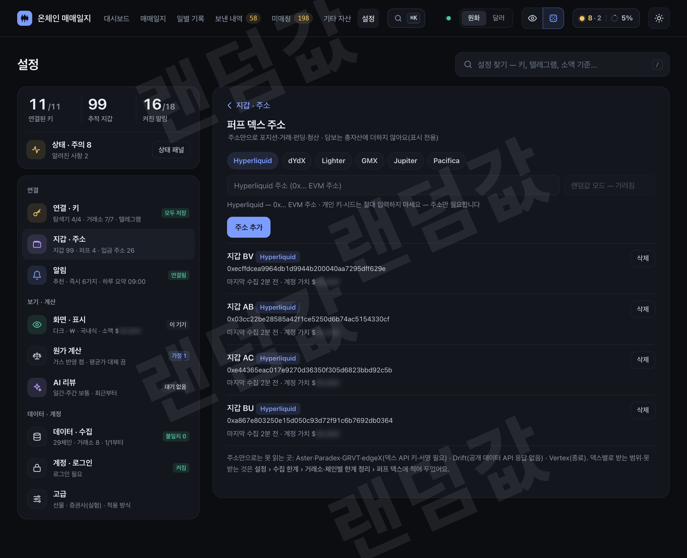

# tj-bot 기능

← [README.md](../README.md)

## 지갑 주소 여러 개 한 번에

- 설정 마법사의 지갑 단계(또는 **설정 › 연결·키 › 지갑**)의 주소 칸에 **쉼표·줄바꿈(Enter)·공백·세미콜론**으로 나눠 여러 주소를 붙여 넣으면 한 번에 추가됩니다.
- EVM(0x…, EVM·BSC 공용)과 Solana 주소를 섞어도 됩니다. 붙여 넣으면 저장 전에 주소마다 형식 확인(EVM 체크섬 포함)·중복을 보여 줍니다.
- 한 번에 최대 50개. 더 많으면 나눠서 넣으세요.
- 이름(별칭)·메모는 추가한 뒤 지갑 목록에서 하나씩 붙입니다.
- **개인 키·시드 문구는 절대 넣지 마세요** — 주소만 필요합니다. 줄로 나뉜 키 조각처럼 보이는 입력은 주소로 저장하지 않습니다.

## AI 기능 켜기 — `claude` CLI 로그인

AI 일별·주간 리뷰와 영수증 AI 매수·매도 평가는 **봇을 돌리는 그 컴퓨터(서버)의 `claude` CLI**(Claude Code)를 그대로 씁니다. 기본은 꺼져 있습니다.

1. **설치** — 봇을 돌리는 컴퓨터에 Claude Code 를 설치합니다(공식 안내: https://docs.claude.com/en/docs/claude-code/setup).
2. **봇과 같은 사용자로 로그인** — pm2 로 봇을 돌리는 사용자(예: 서버의 `tj`)로 들어가 `claude` 를 한 번 실행하고 안내대로 로그인합니다(`/login`).
   - 브라우저가 없는 서버: 로그인 화면이 주는 주소를 다른 기기 브라우저에서 열어 승인하거나,
     `claude setup-token` 으로 만든 토큰을 `CLAUDE_CODE_OAUTH_TOKEN` 으로, 또는 API 키를 `ANTHROPIC_API_KEY` 로 그 사용자의 환경에 둡니다.
     봇은 CLI 에 허용 목록의 환경변수만 넘깁니다(기본 환경·프록시·사내 인증서, Claude 로그인·게이트웨이·Bedrock·Vertex 변수 — 아래 '알아 둘 것' 참고) — `.env` 의 거래소 키 등은 넘기지 않습니다.
   - 봇이 이미 pm2 로 돌고 있으면 새 환경변수(토큰·API 키)는 그냥 재시작으론 안 들어갑니다 — 그 변수를 셸에 넣은 뒤 `pm2 restart tj-web --update-env`(리뷰가 켜져 있으면 `pm2 restart tj-review --update-env` 도) 하고 `pm2 save` 로 바뀐 환경을 저장합니다(안 하면 재부팅 때 예전 값으로 돌아갑니다).
3. **확인** — 같은 사용자로 `claude -p "ok"` 가 대답하면 됩니다.
4. **켜기** — 영수증 평가 = `config.json` 의 `review.buy_eval_daily_max`·`review.sell_eval_daily_max`(하루 상한, 예: 20) 뒤 `pm2 restart tj-web` · 일간·주간 AI 리뷰 = `TJ_ENABLE_REVIEW=1 pm2 start ecosystem.config.js --only tj-review`(이 값은 `.env` 가 아니라 pm2 를 띄우는 셸의 환경변수로 줘야 `tj-review` 유닛이 생깁니다) 뒤 `pm2 save`.
   - 빠진 지난 날 리뷰(처음 켠 뒤 · 리뷰 방식이 바뀐 날)는 설정 › AI 리뷰 › **전체 채우기**로 한 번에 써요 — 확인창에 건수·걸리는 시간 · `tj-review` 가 1분 안에 배경에서 시작(Claude 사용량 · 예약 리뷰는 그대로).

자주 막히는 것:
- 영수증에 **"Claude 접근이 막혀 있어요"** — 로그인한 계정의 조직(팀·회사) 설정에서 Claude Code 사용이 꺼져 있습니다. 관리자에게 켜 달라고 하거나,
  개인 계정으로 다시 로그인하거나 `ANTHROPIC_API_KEY` 를 쓰세요.
- **"Claude 로그인이 필요해요"** — 로그인이 끊겼습니다(다른 사용자로 로그인했거나 토큰 만료). 2번을 봇과 같은 사용자로 다시.
- **"Claude 사용 한도에 걸렸어요"** — 잠시 뒤 '다시 평가'.

## 텔레그램 알림 설정

텔레그램을 연결하면(설정 마법사 › 텔레그램) **설정 › 알림** 에서 알림을 **세 등급**으로 나눠 받습니다. 꼭 필요한 것만 소리가 나요.

| 등급 | 어떻게 오나 | 종류 |
|---|---|---|
| 🔴 **즉시** | 지금 폰을 보고 해야 할 일 · 소리 · 조용한 시간에도 바로 | 봇이 멈춤(몇 분 이상 · 끌 수 없음 — 프로그램·장부 계산·서버·디스크·거래소·시세 수집, 한 수집기의 체인이 모두 함께 멈춤) · 체인 수집 지연(체인 하나가 늦거나 멈춤 — 대부분 저절로 풀려서 기본은 꺼짐 · 상태 패널에서 봄) · 잔고 불일치(하루 넘게 — 수집·재계산 같은 진행 중인 일이 다 끝난 뒤에도 장부와 실제 잔고가 24시간 넘게 다르면 한 번 · 어느 지갑·코인 · 장부와 실제 · 짐작 · 할 일) · 목표가·손절 도달 · 내가 안 한 큰 출금(모르는 주소로 나감 · 내가 옮긴 돈이 제때 안 들어오거나 수수료보다 많이 줄어 들어옴) · 스테이블 가격 이탈(들고 있는 것만) · 청산 근접(선물·대출·마진) · 보유 코인 급등락(켜도 밤엔 모았다가) · 내 이체 도착 확인(소리 없이 — 따로 끌 수 있음) |
| 📋 **하루 요약** | 정한 시각(추천 09:00)에 소리 없이 한 통 · 작은 차트 | 오늘 손익 · 잔고 맞추기 결과 · 처음 보는 토큰 · LP 범위 이탈 · AI 복기 도착 · 기타 자산·증권사 · 안 풀린 봇 문제 · 그 밖의 소식 |
| **시스템** | 텔레그램으로 보내지 않음(상태 패널·설정의 '지난 7일'에만) | 거래 분류·동기화 · 과거 기록 가져오기·다시 계산 |

- **추천값 3종** — 버튼 하나로 채웁니다. 손으로 바꾸면 '직접 설정'으로 표시됩니다.
  - **추천**(새 설치 기본): 즉시 6가지(급등락·체인 수집 지연 제외) + 내 이체 도착 확인(소리 없이) + 하루 요약 한 통, 밤 1시~8시엔 급등락만 모아서
  - **최소**: 즉시 6가지만(요약·도착 확인 없음)
  - **전부**: 급등락·체인 수집 지연까지 모두
- 같은 문제는 **두 번** 알립니다 — 생겼을 때와 풀렸을 때(심해지면 한 번 더). 봇 멈춤이 1시간 넘게 이어지면 한 번 더 알리고, 풀린 뒤 15분 안에 다시 나빠지면 같은 문제로 이어 갑니다(깜빡일 때 여러 통 안 옴). 풀림은 ✅ 로 시작하고 소리가 나지 않아요.
- **큰 출금** — 서버가 이동마다 '모르는 곳으로 나감 / 내 지갑·거래소·브릿지끼리 옮김 / 장부 보정(거래소 잔고 맞춤·차입 반영)'을 나눠서, 모르는 곳으로 나간 것만 바로 알립니다(한 건이 기준 이상이거나 24시간 합계가 기준을 넘을 때 · 여러 건이면 코인·목적지를 전부 한 통에). 내가 옮긴 돈은 보낼 때는 조용하고, 도착하면 걸린 시간·받은 수량·수수료로 줄어든 양을 소리 없이 알려 줍니다(일반 30분·브릿지 2시간 안에 안 들어오면 소리).
- **조용한 시간** — 급등락만 모았다가 끝날 때 한 통으로 보냅니다(나머지 즉시 등급은 밤에도 바로).
- 급등락·큰 출금·디페그·청산 근접·손익 기준 시각·요약 시각은 기준값을 바꿀 수 있어요. **테스트** 버튼으로 그 종류의 예시를 받아 볼 수 있습니다(예시 값은 가짜).
- 가짜 전송·주소 오염 같은 확실한 스캠은 설정과 상관없이 항상 걸러 냅니다. 끈 동안 생긴 알림은 보내지 않을 뿐 기록은 남습니다.
- **체인 수집 지연은 기본으로 안 보내요** — 체인 하나가 늦거나 멈춘 것(탐색기 403·색인 정지·하루 한도 쉼 등)은 대부분 저절로 풀리고 할 일이 없어서,
  추천·최소와 새 설치에서는 꺼져 있어요(이미 쓰던 설치도 이 칸은 꺼진 채로 시작 — '전부'를 누르거나 그 줄 스위치를 켜면 받음).
  꺼 둬도 상태 패널·대시보드 상태 카드에는 그대로 보이고, 한 수집기의 체인이 모두 함께 멈추면 '봇이 멈춤'으로 꼭 알려요.
  이더스캔 키 안내·공개 RPC 대체 소식도 텔레그램이 아니라 상태 패널에만 떠요.

## 금액 랜덤값 모드

화면을 남에게 보여 주거나 캡처할 때 실제 금액 대신 그럴듯한 가짜 숫자를 보여 주는 모드입니다(위 스크린샷이 전부 이 모드).

- 켜기: 화면 위 **주사위 버튼** 또는 **설정 › 표시 › 금액 랜덤값**.
- 금액·수량에 **페이지를 열 때마다 새로 정해지는 같은 배수**를 곱해 보여 줍니다. 합계·차트 모양은 서로 맞고, 퍼센트·단가·날짜·건수는 그대로라 예시 화면처럼 자연스럽습니다.
- 화면 전체에 **'랜덤값' 워터마크**가 깔려 실제 숫자로 오해할 일이 없습니다.
- **실제 금액은 저장소에 닿지 않습니다.** 배수는 기본으로 어디에도 저장하지 않고(새로고침하면 바뀜), 원장·설정은 그대로이며,
  켜 있는 동안 금액·메모 입력 칸은 비우고 잠가 랜덤 숫자가 저장될 일이 없습니다. 이 기기의 브라우저 저장본도 쓰지 않습니다.
  AI 설명 글처럼 배수를 맞출 수 없는 글은 통째로 가립니다.
- **배수 고정(선택)** — 캡처 여러 장의 숫자를 서로 맞추고 싶으면 **설정 › 표시 › 금액 랜덤값**에서 배수를 고정할 수 있어요(0.2~5, 실제와 비슷한 0.8~1.25 는 안 됨).
  이 기기 브라우저에만 저장되고, 랜덤값이 켜진 동안에는 고정한 값을 화면에 내지 않습니다. 배수를 아는 사람은 실제 값을 계산할 수 있으니 값은 혼자만 아세요.
- 켜 두면 탐색기 링크를 빼고(주소·해시로 실제 지갑을 찾아갈 수 없게), 서버도 첫 화면 HTML 에 실제 총자산 요약을 넣지 않습니다.
- **내가 쓴 이름·메모도 가려요** — 지갑 이름·별명·보낸 곳 별명·메모·텔레그램 봇과 채팅 이름처럼 내가 직접 붙인 글은 **'지갑 A'·'메모'** 같은 표식으로 바꿔 보여 줘요
  (같은 이름 = 같은 표식 · 페이지를 연 동안 고정 · 주소는 종전처럼 앞뒤만). 그 글이 든 입력 칸·검색 결과·문장 속 이름도 같은 표식으로 바뀌고, 금액 가리기(숨김)에서도 똑같이 동작합니다.
- **텔레그램 연결 QR·코드는 숨겨요** — 가림 중에는 연결 QR·연결 링크·/start 코드를 보이지 않아요(남이 캡처해 내 봇에 연결하지 못하게 · 끄면 다시 보여요).
- **지난 검색어는 지워요** — 가림을 켜면 검색창의 최근 검색어를 이 기기에서 지우고 새로 남기지 않아요. 저장해 둔 검색 조건은 가림 중에만 숨깁니다.
- 금액 가리기와 둘 중 하나만 켜집니다.

## 금액 가리기(숨김 모드)

- 화면 위 **눈 버튼** 또는 **Shift+H**(설정 › 표시에서도). 금액·수량·단가를 흐린 가짜 글자로 바꿉니다.
- 퍼센트·건수·날짜는 그대로 보이고, AI 설명 글은 숫자가 섞여 있어 통째로 가립니다.

## 기타 자산 — 증권사 연결은 미검증

코인 밖 자산(부동산·주식·금·자동차·현금·기타·부채)을 직접 적어 두면 대시보드 '전체 순자산'에 더해집니다. 주식·금은 공개 시세(약 15분 지연)로 평가합니다.

> **증권사 연결은 미검증입니다 — 공개 문서만 보고 작성했고, 실제 계정으로 시험하지 않았습니다.**
> 한국투자·키움·LS·DB·토스·Alpaca·IBKR·Schwab 어댑터가 있지만 모두 기본 꺼짐(`config.json` 의 `brokers.*.enabled: false`)입니다.
> 읽기 전용(보유·예수금 조회만, 주문 코드 없음)이며, 실제로 켜면 필드 이름·연속 조회·오류 코드가 문서와 달라 실패할 수 있습니다.
> 증권사별 필드·주의점은 [src/brokers/README.md](../src/brokers/README.md) 에 있습니다.

## NFT 보유 · 바닥가

**기타 자산 › NFT** 에서 지갑의 NFT 와 컬렉션 바닥가를 봅니다. **표시 전용**이라 원장·손익·AI 리뷰에는 들어가지 않습니다.

- **자동 발견(하루 1회)** — EVM 은 블록스카웃(없으면 이더스캔 키), Solana 는 Helius. 등록한 지갑 + 활동이 확인된 체인만 봅니다.
  표준(ERC-721) 이전 NFT(**크립토펑크·원조 문캣**)도 자동으로 잡습니다. LP 포지션 NFT 는 LP 화면이 따로 추적하므로 개수만 보여 줍니다.
- **분류**
  - **추적 중(자동 포함)** — 바닥가와 최근 거래량이 확인된 컬렉션. 바닥가 × 개수로 평가하고 오늘 변동·7일 추이를 보여 줍니다(추적 대상은 1시간마다 갱신).
  - **후보** — 바닥가는 있는데 거래량이 없거나, 시세는 없지만 내가 사거나 민트한 것 등. 고르면 **추적**, 아니면 **숨김**.
  - **스팸 접힘** — 링크·보상 유도 이름, 유니코드 속임 글자, 대량 에어드랍, 남이 공짜로 보낸 시세 없는 NFT 등. 사유 칩이 붙고, 잘못 걸렸으면 펼쳐서 **'정상으로'**.
  - **지켜보기** — 갖고 있지 않아도 컬렉션 주소나 매직에덴·오픈시 링크를 넣어 바닥가만 지켜봅니다.
- **총자산에 포함** 스위치(기본 꺼짐) — 켜면 대시보드·기타 자산의 '전체 순자산'에 NFT 줄이 더해집니다(코인 총자산 숫자는 그대로).
- **바닥가 출처** — Solana = 매직에덴(1시간마다). EVM = `TJ_OPENSEA_KEY` 가 있으면 오픈시 체인은 **오픈시만**, 그 밖 체인·키 없으면 코인게코 NFT.
  코인게코는 키 없이도 되지만 공용 무료 한도라 처음엔 몇 시간 걸릴 수 있어요 — 그동안 화면 위 안내(하루 1회 텔레그램 안내 포함)가 뜨고,
  무료 **Demo 키**(`TJ_COINGECKO_KEY`)를 **설정 › 연결·키 › 탐색기 키** 에 넣으면 금방 채워집니다. 유료 **Pro 키**도 같은 칸에 넣으면 됩니다 —
  저장·연결 테스트 때 데모/프로를 자동으로 판별하고(프로는 주소가 `pro-api.coingecko.com` 으로 다름), 프로 키는 보통 다른 곳에서도 쓰는 키라
  코인게코가 알려 주는 플랜 한도(분당·월)의 **10%** 만 씁니다(같은 화면의 **사용 비율** 버튼으로 25·50·80% 까지 — 80% 가 상한). 한 달 몫은 남은 날에
  고르게 나누고, 같은 키를 쓰는 다른 곳의 이번 달 사용량이 많으면 그만큼 더 줄여 계정 전체가 80% 를 넘지 않게 합니다.
  등급·비율·지금 쓰는 몫은 같은 화면에 표시됩니다(키 값은 표시하지 않음).
  이 키는 NFT 만이 아니라 코인게코 시세·DEX 토큰 시세·원가·차트도 같이 씁니다(하루 몫을 기능별로 나눔 — [docs/API_KEYS.md](API_KEYS.md)).
  오픈시 연결은 공개 문서 기준(키 없이 실호출 시험은 못 함).
- 무료 탐색기 API 가 NFT 목록을 주지 않는 체인은 제외되고, NFT 이미지는 외부 주소라 불러오지 않습니다(머리글자 표시). 호출은 무료 한도의 절반 이하로 천천히 합니다.

## Hyperliquid — 현물 · 무기한 · 스테이킹

- **설정 › 연결·키 › 퍼프 덱스** 에서 Hyperliquid 를 고르고 주소만 넣으면(키 없음 — 공개 조회 API) 무기한 포지션·실현 손익이 선물 화면에 나옵니다.
- `config.json` 에 `"hyperliquid": {"spot": true}` 를 넣고 `tj-exf`·`tj-web` 을 재시작하면 같은 주소의 **HyperCore 현물 체결·입출금**과
  **현물 + 무기한 현금 + 스테이킹 HYPE 잔고**를 거래소 'hyperliquid' 처럼 원장에 넣고 잔고 대사까지 합니다(빼고 싶은 주소는 `"spot_exclude": ["0x…"]`).

- 아비트럼 브릿지로 보낸 USDC 입금은 보낸 내역에서 Hyperliquid 입금과 자동으로 이어집니다. 시세는 같은 코인이 확인된 토큰만 아래 순서(바이낸스 → 바이빗 → 코인게코)를 쓰고,
  Hyperliquid 고유 토큰은 Hyperliquid 현물 중간가를 씁니다. 조회는 공개 한도의 3분의 1 이하로 천천히 합니다.

## 시세 출처 · 동명 코인 거르기

- **달러 시세 순서 = 바이낸스 → 바이빗 → 코인게코.** 원화 마켓이 없는 업비트·빗썸 보유 코인, 원가(매수 시점 1분봉), 장기 곡선·그날 마감가가 이 순서를 씁니다
  (원가용 1분봉만 바이빗 다음에 업비트 원화 1분봉 ÷ 그 분 환율도 봐요 — 업비트 원화 마켓에만 있는 코인).
- **원화 환율(업비트 USDT 원화 호가)** 은 받은 시각과 함께 둡니다. 1시간 넘게 못 받으면 화면 숫자는 마지막 값으로 보이되(상태줄·설정 환율 줄에 '환율 오래됨' · 고정 대체값이면 '환율 대체값' + 김프 숨김) 그날 마감은 미루고, 그날은 그 시각 1분봉 환율로 닫습니다(고정 대체값은 마감·곡선에 저장하지 않음).
- **업비트·빗썸의 USDT·BTC 마켓 시세는 쓰지 않습니다**(거래가 얇아 튀는 일이 잦음). 원화 마켓 시세와 원화 환산용 업비트 KRW-USDT 는 그대로 씁니다.
- **동명 코인 거르기** — 같은 티커라도 다른 코인일 수 있어, 코인게코 매핑이 다른 코인이라고 하거나 기준가와 0.5~2배 넘게 어긋나면 그 거래소 시세를 버리고 사유를 남깁니다.
- 온체인 토큰은 그 체인의 DEX 실가(얇은 풀의 비정상 가격은 평가 제외 · 풀 유동성을 모르는 가격도 OKX DEX 값이 10% 안에서 같을 때만 씀)로 평가하고, 원가가 필요한데 거래소 1분봉이 같은 코인으로 확인되지 않으면 코인게코(컨트랙트 주소)를 씁니다.
- **대표 심볼 '확인 필요'** — USDT·WBTC 같은 대표 심볼인데 정품 목록(내장 + `state/genuine_tokens.json`)에 없는 컨트랙트는 심볼만으로 숨기지 않습니다.
  유동성 있는 시세(풀 유동성이 `price_guard.min_reserve_usd` 이상)나 거래소 출금 도착이 있으면 정품으로 보고, 아니면 보유표 '값 없는 토큰'에 **확인 필요** 배지로 보입니다.
  확인 전에는 평가 0 — 총자산·일별 기록·알림에 넣지 않습니다(주소 오염용 가짜 USDT 대비). 배지를 눌러 **정품으로 등록**하면 그 심볼 시세(스테이블은 액면 $1)로 평가하고 남이 보낸 토큰의 '에어드랍 의심' 격리도 풉니다(고플러스 스캠 확증은 그대로 · 풀기 = 보유 상세의 '직접 등록' 표식).
  보이지 않는 글자·유사 글자가 섞인 이름은 종전대로 사칭으로 숨깁니다.
- **코인게코 키**(`TJ_COINGECKO_KEY`, 선택)가 있으면 코인게코·GeckoTerminal 조회를 키로 먼저 부르고, 키 몫이 모자라거나 실패하면 그 콜만 예전처럼 무키로 부릅니다.
  순서는 그대로 — 거래소 값이 있는 코인은 코인게코를 부르지 않고, 그 코인의 확인용 조회(동명 거르기 기준가)는 키 몫을 아끼려고 무키로 둡니다.

## 일별 기록 — 그날 카드 · 'M월 한눈에'

- **그날 카드** — 그날 총자산 변동을 시세·실현·입출금·환율로 나누고, **시세(평가) 몫은 코인별 표**(전일 수량 × 가격 변화 — 전일 마감가 → 그날 마감가(오늘은 지금 시세) · 변동률 · 기여 금액)로 펼쳐 보여 줍니다.
  30분 체결 막대, 그날 실현 기여, 매매 근거 메모(코인별 한 줄)도 같은 카드에 있습니다.
- **'M월 한눈에'** — 달력 아래에 그 달 자산 변동 분해(시세·실현·LP 수수료·입출금·환율·나머지)와 실현 상위·하위 5를 한 장으로 보여 줍니다.
- **변동 분해 줄 → 무엇 때문인지** — 대시보드 '오늘 무엇이 움직였나'·그날 카드·'M월 한눈에'의 분해 줄을 누르면 시트(폰은 아래에서 올라옴)가 열려 그 줄을 이룬 것을 큰 순으로 보여 줍니다 —
  시세는 코인별(변동률·전일 수량·전일가 → 그날가), 현물 실현은 코인별(누르면 차익 영수증), 선물은 거래소·종목별, 입출금은 건별(상계된 레그), 환율은 몫별,
  나머지는 이름 붙인 조각(가격 끊김·원장 밖 잔고·반올림 등). 설정 '목록 한 쪽'(10/20)씩 넘기고, 맨 아래 합 확인 줄이 늘 위 줄 값과 같아요. 그 달은 항목별/날짜별로 바꿔 볼 수 있어요.
  금액 숨김·랜덤값 모드에선 상세 금액을 서버에서 받지 않고 큰 항목만 보여요.
- **원화 입출금** — 업비트·빗썸의 은행 원화 입출금(거래소가 주는 예치금 이용료 같은 내부 지급 포함)이 그날 기록에 한 줄씩 나와요.
  최근 30일은 빗썸 원화 입출금도 그날 카드 '입출금'(순유입)·보관처별 들어옴/나감·자산 변동 분해에 들어가고, 빗썸 원화로 산 코인은 매매로 나눠 보여 줘요
  (장기 곡선의 입출금은 종전대로 업비트만).

## 옛 보유 토큰 찾기 · 체인 표

수집 기간(기본 5개월)보다 먼저부터 들고만 있던 토큰은 거래 기록에 안 보여서, 지갑을 등록할 때(기초 잔고 대조) 따로 찾습니다.

- **찾는 법** — 체인마다 되는 출처를 합쳐 그 지갑이 한 번이라도 주고받은 토큰을 모두 모으고(이더스캔·루트스캔·블록스카웃·Alchemy·Ankr·Rabby 포트폴리오(켰을 때만)·RPC 로그 훑기 + 원장의 정품 토큰),
  같은 블록의 잔고로 기초 잔고를 맞춰요. 스팸 의심 토큰은 넣지 않아요.
- **얼마나 부르나** — 키 쓰는 API(Alchemy·Ankr)는 처음 1번 전수 + 무료 신호(새 거래·잔고·nonce)로 움직임이 보인 (지갑, 체인)만 다시 부르고, 안 쓰는 지갑은 0콜이에요.
  서비스마다 하루 장부로 무료 한도의 80% 안([docs/API_KEYS.md](API_KEYS.md)).
- **체인별** — 무료로 되는 체인: Ethereum·Arbitrum·Polygon·Optimism·zkSync·Scroll·Gnosis·Linea·Blast·Avalanche·Abstract·HyperEVM·Monad 등(이더스캔 무료 키·블록스카웃·루트스캔) ·
  느린 체인: Kaia·BOB·0G(RPC 로그를 훑어요 — 등록 때 1번, 지갑당 몇 분~수십 분) ·
  **키가 없으면 '옛 보유 확인 불가': Base·BNB Chain(Alchemy 또는 Ankr 무료 키)·X Layer(Ankr 무료 키)** — 키가 없으면 원장의 정품 토큰·검증 스테이블만 확인하고,
  놓친 토큰은 옮길 때 원장 마이너스로 드러나요(아래 '발견 시점 기초 잔고'가 바로잡음). 체인별 출처표 = `seed/coverage/token_sources.json` · 화면 = **설정 › 수집 한계** ·
  [docs/COLLECTION_LIMITS.md](COLLECTION_LIMITS.md) 의 '옛 보유 토큰 찾기' 줄.
- **발견 시점 기초 잔고** — 그래도 놓친 토큰을 내보내 원장이 마이너스가 되면, 그 거래 직전 블록의 실제 잔고(무료 RPC)로 확인된 만큼 기초 잔고(원가 미상 · 발견 시각 시세로 추정)를
  자동으로 적어요(지난날 곡선은 그대로 · 확인이 안 되면 마이너스 그대로 두고 다시 시도).
- **이미 등록한 지갑** — 잔고 대조가 하루쯤에 걸쳐 돌아가며 확인해요. 한 번에 전부 보려면 1회 도구로(둘 다 기본 = 미리보기):
  `python3 tools/token_recheck.py --plan-only`(예상 콜·시간) → `python3 tools/token_recheck.py --out recheck.jsonl --progress recheck_prog.json`(점검 · 원장 쓰기 없음 · 끊기면 같은 명령으로 이어서) →
  `python3 tools/negabs.py --recheck recheck.jsonl`(무엇을 적을지) → 같은 명령에 `--apply`(tj-core 가 다시 확인한 뒤 기장 · 결과 = `state/negabs_result.json`·`pm2 logs tj-core`).
  업데이트 전에 이미 생긴 마이너스 칸만 보려면 `python3 tools/negabs.py`(`--rpc` = 직전 블록 잔고까지 확인) → `--apply`.
- **EVM 체인 표** — Alchemy 가 지원하는 EVM 메인넷 73개 = `seed/coverage/evm_chains.json`(체인 id·Alchemy 네트워크 이름·토큰 API 지원·'무료 경로 있음 / Alchemy 필요'·잔고 찾기·백필 보조·감시 예비 경로).
  표에 있다고 추적하지는 않아요 — 추적은 종전처럼 하루 1번 미추적 체인 점검에서 활동이 보이면 켜져요(설정 › 지갑 · 주소 › 체인별 조회에서 끔). Alchemy 앱에서 네트워크를 꺼 두면
  그 체인 조회가 막히니 앱의 네트워크는 전부 켜 두세요.
- **받기만 한 옛 토큰** — 수집 기간 전부터 들고만 있던(기초 잔고뿐 · 이 기간에 사고판 적 없는) 토큰은 코인게코에 그 컨트랙트 시세가 있을 때만 평가해요 — 받기만 한 스캠 토큰이
  총자산을 부풀리지 않게(없으면 0 · 격리 줄 · 정품 등록하면 평가). DEX 조회가 잠깐 실패해 판정을 미룬 토큰은 1시간마다 다시 판정하고 그동안 상태 패널에 '토큰 판정 대기 N'(노랑)이 보여요.
- **정품 등록(도구)** — 남이 실행한 교환·LP 로 나간 일반 토큰(정품 목록 밖)이 마이너스로 남으면 `python3 tools/negabs.py --genuine <CA> --chain <체인> --wallet <주소>`(미리보기) → `--apply`(정품 등록 + 그 칸 다시 시도).
- 끄기 — `config.json` 의 `"token_discovery": {"enabled": false}`(종전 대사로) · `"negabs_enabled": false`(발견 시점 기초 잔고 끔).

## 기능 요약

- **지갑 수집** — EVM(Ethereum·Base·Arbitrum·Optimism·Polygon·Scroll·zkSync·Gnosis) + BNB Chain + Solana.
  **Tron·Sui·TON·Bitcoin**(읽기 전용 · 키 없이도 됨 — Tron·TON 은 무료 키 권장)은 설정 › 지갑 · 주소에서 체인을 골라 추가해요.
  Bitcoin 은 주소 하나 또는 HD 지갑(공개 디스크립터·xpub/ypub/zpub — 받는·잔돈 주소를 gap 20 으로 찾음 · 개인 키·시드는 거부).
  지원 범위와 한계(Sui 스테이킹 객체 · Tron 동결 TRX · Bitcoin 깊은 재편 · TON 스왑 미확정)는 [수집 한계](COLLECTION_LIMITS.md#tron--sui--ton--bitcoin).
  추가 EVM 체인(Monad·MegaETH·Plasma·X Layer·Kaia·Fraxtal·BOB·Story·Somnia·Avalanche·Stable·Abstract·HyperEVM·Arc·Robinhood 등)은
  등록 주소에 활동이 확인되면 켤 수 있습니다(`chain_sweep` — 기본은 알림만, `auto_enable` 로 자동 추적 · HyperEVM 은 이더스캔 무료 키가 있을 때 · 이더스캔 목록만으로 받음).
  안 쓰는 체인은 설정에서 스위치 하나로 끄고(끄기 추천 표시), 확인 주기는 지갑 수와 탐색기·헬리우스 하루 몫(80%)에 맞춰 스스로 조절합니다.
  하루 몫은 옛 기록 채우기가 먼저 쓰고, 탐색기가 막히면 그 체인을 공개 RPC 로 이어 받습니다(Base 는 공개 RPC 전용 · Solana 새 거래는 공개 노드 먼저).
- **거래소 연결(선택)** — 업비트·빗썸·바이낸스·바이빗·OKX·쿠코인·게이트·코인베이스. 입금·출금·체결·잔고(마진·Earn·선물 손익 포함)를 읽어
  "지갑 → 거래소 입금 → 매도" 흐름을 한 사이클로 묶고 원가를 이어 줍니다. 원화 입출금도 따로 보여 줍니다.
  바이낸스·바이빗·OKX·쿠코인·게이트는 **서브계정 키**도 넣을 수 있어요(거래소마다 5개까지 · 같은 거래소로 합쳐 세고 기록 줄에 `· 서브1` 딱지).
- **퍼프 덱스(선택)** — 주소만으로 공개 조회되는 곳(Hyperliquid·GMX 등)의 포지션·정산. **Hyperliquid** 는 현물·무기한 현금·스테이킹까지 원장·대사(선택).
- **NFT(표시 전용)** — 보유 자동 발견(크립토펑크 등 표준 이전 NFT 포함), 바닥가·거래량 확인된 컬렉션 자동 추적, 후보·스팸 거르기·지켜보기, 총자산 포함 스위치.
- **LP** — Uniswap v3/v4·PancakeSwap·SushiSwap·Aerodrome/Velodrome Slipstream·Meteora DLMM 등 포지션 원금·수수료 평가.
- **손익** — 사이클별 투입·실현·미실현, 차익 영수증(매수·매도 한 차트·점수), 선물 영수증(그날 선물 정산 — 진입·청산 차트), 월/일 실현손익 달력과 매매 근거 메모,
  전일 대비 분해(시세 몫은 코인별 표 · 줄을 누르면 무엇 때문인지), 'M월 한눈에', 장기 총자산 곡선(1년·전체), 가스·수수료, 신고용 양도차익 명세(참고용 표).
- **내 매매 돌아보기** — 타임머신 · 자금 흐름 지도 · 팔기 전 미리보기 · 올해 결산 · 계획 지키기 점수 · 매매 습관 · 하루 실현 잔디 · BTC 비교선.
- **전체 검색** — ⌘K(또는 /)로 코인·주소·해시·날짜·금액·메모·리뷰를 한 번에(필터 문법 `coin:` `chain:` `type:` `after:` `pnl:` `amt:` …, 문장 검색).
- **옛 보유 토큰 찾기** — 지갑 등록 때 체인별 무료·키 출처 합집합으로 주고받은 모든 토큰을 찾아 같은 블록 잔고로 기초 잔고 · 놓친 토큰은 나갈 때 직전 블록 잔고로 바로잡음([자세히](#옛-보유-토큰-찾기--체인-표)).
- **상태 패널·알림** — 수집기·외부 API 지연, 온체인 잔고 상시 대조(불일치 알림), 원장 정기 백업 상태, 텔레그램 알림 3등급(즉시 · 하루 요약 · 시스템).
- **가격** — 토큰은 그 체인의 DEX 실가(얇은 풀의 비정상 가격은 평가 제외), 거래소 보유분은 그 거래소 시세(업비트·빗썸 = 원화 마켓 · 해외 거래소 = 그 거래소 달러 시세 · 다른 거래소 값으로 대신하지 않음), 달러 시세는 바이낸스 → 바이빗 → 코인게코
  (업비트·빗썸 USDT·BTC 마켓은 쓰지 않음 · 동명 코인 거르기), 원화 환산은 업비트 KRW-USDT. 금액 랜덤값·가리기 모드로 화면 공유도 안전하게.
- **AI(선택, 기본 꺼짐)** — 일간·주간 리뷰(`TJ_ENABLE_REVIEW=1 pm2 start ecosystem.config.js` 로 `tj-review` 유닛 추가)와
  영수증 AI 매수·매도 평가(`config.json` 의 `review.*_eval_daily_max` 를 0 보다 크게). 둘 다 내 컴퓨터의 `claude` CLI 로 요약을 보냅니다.

## 원가 · 손익 계산 방식

원가·손익은 모두 **달러(USD)로 계산**하고, 원화는 업비트 USDT 원화 시세(김프 포함)로 바꿔 보여 줘요.
원장에는 거래마다 그 시각 달러 시가만 적어 두고, 평단·실현·명세는 화면을 만들 때마다 원장을 처음부터 다시 재생해 계산해요 —
아래 설정을 바꾸면 지난 숫자도 새 규칙으로 다시 계산되고, 원장 자체는 바뀌지 않아요.

### 평단 — 이동평균(선입선출 아님)

- **평단 = 남은 원가 합 ÷ 원가를 아는 수량.** 살 때마다 원가·수량이 더해져 평단이 다시 잡히고, 팔면 `평단 × 판 수량` 만큼 원가가 빠져요(남은 평단은 그대로).
- **실현 손익 = 판 금액 − 평단 × 판 수량** (수수료·가스는 아래 표).
- **평단을 함께 쓰는 묶음**
  - ETH·SOL·BNB 같은 체인 기본 코인 = 체인이 달라도 한 묶음(그 체인 공식 랩 토큰 WETH 등 포함)
  - 정품 목록의 스테이블(USDT·USDC 등) = 이름별 한 묶음
  - 그 밖 토큰 = 체인·컨트랙트마다 따로 · 거래소 보유 = 거래소·코인마다 따로(업비트 BTC 와 바이낸스 BTC 는 평단이 따로)
  - 보유표는 같은 이름을 한 줄로 모아 보여 주고, 줄을 펼치면 보관처별 평단이 보여요.
- **같은 거래 안**(스왑 등)에서는 파는 쪽을 그 거래 전 평단으로 먼저 계산한 뒤 산 쪽을 반영해요.
- **같은 초**에 겹친 거래는 블록 번호·블록 안 순번·거래소 체결 시각(밀리초)·체결 번호로 순서를 정하고, 그래도 모르면 보유가 모자라지 않는 순서로 재생해요.

> 예(합성 값) — ETH 1개를 $2,000, 1개를 $3,000 에 사면 평단 $2,500. 1개를 $3,500 에 팔면 실현 +$1,000, 남은 1개 평단은 그대로 $2,500.

### 내 지갑 · 거래소 사이 이동

- 이동은 매매가 아니라 손익이 없어요. 보낸 수량은 **출발지 평단 원가를 그대로 들고 가고**, 도착지에 같은 코인이 이미 있으면 둘이 섞여 도착지 평단이 다시 잡혀요.
- 짝 찾기 — 거래소 입금·출금은 txid(없으면 수량·시간·입금 주소), 브리지는 출발·도착 수량(98~102%)·시간. 그래서 '지갑에서 산 코인 → 거래소 입금 → 매도'가 산 값 기준으로 계산돼요.
- 짝을 못 찾은 도착은 아래 '원가를 모를 때'로 가요. 보낼 때는 원가를 모르는 수량이 먼저 나가요(도착에서도 원가 미확인 그대로).

### 수수료 · 가스

| 무엇 | 반영 |
|---|---|
| 거래소 매수 수수료 | 산 코인 원가에 더함(업비트는 체결 원화에 이미 포함) |
| 거래소 매도 수수료 | 그 매도의 실현에서 뺌 |
| 스왑 매수 가스 · 스왑 매도 가스 | 산 코인 원가에 더함 · 그 매도의 실현에서 뺌 |
| 매매 아닌 가스(승인·전송·실패·브리지·LP) | 그날 실현에서 '가스(매매 외)'로 뺌 |
| 거래소 출금 수수료 · 브리지 수수료 | 그 시각 시가를 그날 비용으로 뺌 |
| 수수료로 나간 코인 자체 | (그 시각 시가 − 평단) × 수량 = 처분 손익(명세 '수수료로 쓴 코인') |

- **설정 › 원가 계산 › 가스를 원가·실현에 반영**(기본 켬 · `config.json` 의 `gas_in_cost`)을 끄면 가스·출금·브리지 수수료 금액은 '가스·수수료' 탭에 따로 보이기만 해요.
  거래소 체결 수수료와 수수료 코인 처분 손익은 켜든 끄든 그대로예요.

### 원화

- 업비트 원화 마켓 매수 원가 = (체결 원화 + 수수료) ÷ 그 분 업비트 KRW-USDT, 매도 금액 = (체결 원화 − 수수료) ÷ 같은 환율.
- **실현 손익의 원화 = 달러 실현 × 판 시각 환율.** 그 코인을 전부 원화 마켓에서 샀다면 원화 실현 = 받은 원화 − 낸 원화.
- 지금 보유·총자산·미실현의 원화는 지금 환율이에요.
- 정품 스테이블의 **평가는 액면 $1**(시세가 흔들려도 $1)이지만, 원가는 확인된 매수 대가·이동·환불 원가를 보존해요(원가를 모르는 유입은 액면). 원화로 산 USDT 의 원화 환차손익은 명세의 '스테이블 환차손익' 줄에만 들어가요.
- 은행 ↔ 거래소 원화 입출금은 손익이 아니에요(일별 기록 '원화 입출금').

### 원가를 모를 때 — 기초 잔고 · 에어드랍 · 출처 모르는 입금

- **기본 = 최초 인식 시가(추정)** — 그 수량이 장부에 처음 생긴 날 시가를 원가로 잡아요(수집 시작 전 보유는 수집 시작일 · 받은 날 판 몫은 판 값). 한 번 잡은 값은 고정이고 명세·카드에 '추정'으로 보여요.
  보냈다가 돌아온 코인(보낼 때 원가를 이어받음) · 확인 안 된 토큰 · 나중에 판 값의 10배 넘는 시세 · 그날 시세 없음은 매기지 않아요.
- 그래도 모르는 수량은 **평단에서 빼고** 따로 들고 있어요. 팔 때는 원가 아는 수량부터 떼고, 모르는 몫의 매도는 실현에서 빠져 **'원가 미확인'**(미매칭 탭)으로 남아요.
- **미매칭 › 원가 미확인 항목** — '원가 적용'(개당 달러) · '당시 시세로 추정' · '손익 0 처리'(누른 때까지의 매도를 매수가 = 매도가로).
- **설정 › 원가 계산** — 최초 인식 시가(기본 켬 · `config.json` 의 `first_seen_px`) · 평균가 대체(기본 끔 — 켜면 그 종목 평균 매수가로, 이때 최초 인식 시가는 쉼) · 지정한 원가 되돌리기.
- 우선순위 = 직접 넣은 원가 > 손익 0 처리 > 평균가 대체 > 최초 인식 시가 > 원가 미확인.

> 예(합성 값) — 평단 $2,500 짜리 1 ETH 에 기초 잔고 0.5 ETH(수집 시작일 시가 $2,800)가 있으면 평단 = ($2,500 + $1,400) ÷ 1.5 = $2,600.
> 최초 인식 시가를 끄면 0.5 는 원가 미확인 — 1.2 ETH 를 $3,000 에 팔면 1개 몫 실현 +$500, 나머지 0.2개($600)는 '원가 미확인'.

### 미실현 · 총자산

- **미실현 = (지금 시세 − 평단) × 원가 아는 보유 수량.** 원가 미확인 보유는 총자산엔 들고 미실현엔 안 들어요.
- 시세 — 거래소 보유는 그 거래소 시세, 체인 기본 코인은 거래소 시세, 토큰은 그 체인 DEX 가격([시세 출처](#시세-출처--동명-코인-거르기)).
  보유 평가가 풀 유동성보다 크거나 믿을 시세가 없으면 평가 0('값 없는 토큰')이라 총자산·손익에서 빠져요.
- **총자산 = 스테이블 + 코인(수량 × 지금 시세) + 원화 예수금 + LP(평가 + 미청구 수수료·보상) − 거래소에서 빌린 몫 − Rabby 차입.**
  선물 열린 포지션의 미실현은 넣지 않아요. 기타 자산 탭의 '전체 순자산' = 총자산 + 기타 자산 − 부채(+ NFT, 켰을 때).
- 전일 대비 = 시세(평가) + 실현 매매 + LP 수수료 + 입출금 + 환율 + 원가 모름 + 나머지.

### 선물 · LP · 스테이킹 · 대출

- **선물·퍼프** — 거래소가 준 정산(실현 손익 · 수수료 · 펀딩)을 정산 시각에 그대로 써요(평단 계산 없음 · 코인 정산은 정산 시각 시세로 달러). 그날 '총 실현' = 현물 + 선물.
- **LP** — 예치는 이동(원가 그대로). 회수 때 다른 코인으로 바뀌어 나오면 그 시각 시가와 원금 원가의 차가 실현, 받은 수수료·리워드는 받은 시각 시가로 실현이에요.
- **스테이킹 보상**(Solana) — 받은 시각 시가로 실현(소득)하고, 그 값이 그 코인 원가예요.
- **대출** — 거래소에서 빌린 몫은 음수 보유로 총자산에서 빼요. 원장에 부채 이자 행으로 확인된 몫은 가스 반영을 켜면 그날 실현 비용이고, 이자로 쓴 코인의 처분 손익도 반영해요. 빌려서 출금해 판 코인은 `loan_short`(기본 꺼짐)를 보세요.

### 양도차익 명세 — 참고용

- 매도 한 건마다 취득가액 = 평단 × 수량, 양도가액 = 판 금액, 수수료 열 = 매도 수수료·가스.
- 원화 양도가액 = 판 시각 환율 · 원화 취득가액 = 산 때 원화(원화 마켓은 낸 원화, 그 밖은 산 시각 환율)의 이동평균 — 기록이 없으면 판 시각 환율.
- 원가 미확인 매도는 명세에서 빠지고, 추정(최초 인식 시가 · 평균가 대체 · 손익 0 처리) 행은 표시가 붙어요.
- **이동평균 기준이라 선입선출·개별 지정으로 신고하면 숫자가 달라요.** 기본공제·시행 전 보유분 취득가 특례 같은 세법 규칙도 반영하지 않았어요 — 실제 신고는 거래소 공식 내역과 세무 전문가 확인을 따르세요.

### 숫자를 믿을 수 있게

- 원본(raw)은 그대로 보관하고 원가·손익은 그때마다 다시 계산해요 — 원장 재계산은 [백필 · 재구축](OPERATIONS.md#백필--재구축--재백필).
- 계산 중 코드 실수 꼴 오류가 나면 화면은 계속 돌되 상태 패널에 빨강 **'계산 코드 오류를 삼킴 — 숫자가 틀렸을 수 있음'** 과 텔레그램이 와요.
- 알려진 한계 — 수수료로 확인되지 않은 이동 수량 차이(도착이 조금 적음)는 그 몫 원가가 손익 없이 빠지고, 같은 블록 순서 등은 [알려진 한계](OPERATIONS.md#알려진-한계)에 있어요(거래소 수수료 리베이트(음수 수수료)는 이제 실현에 들어가요).
